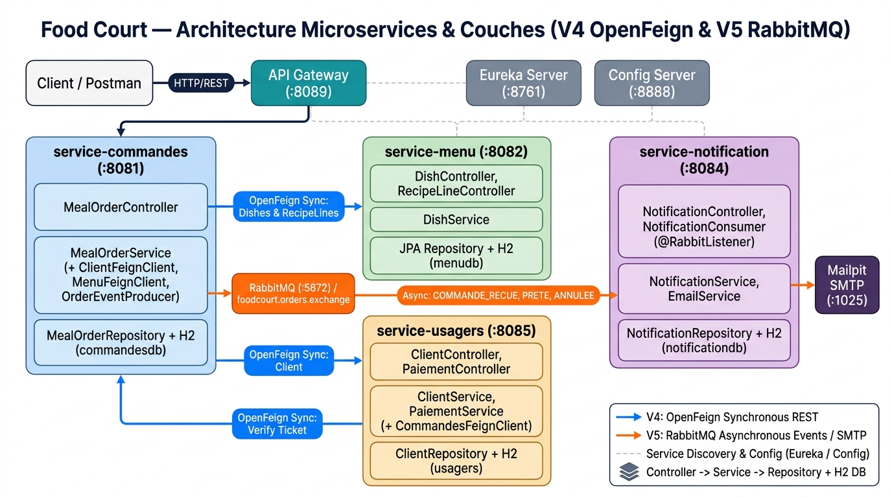

# Guide de Démonstration — Contrôle Food Court (V4 OpenFeign & V5 RabbitMQ)



## 1. Démarrage (dans l'ordre)

### A. Docker (RabbitMQ + Mailpit)
```powershell
docker start rabbitmq mailpit
```
*(Si c'est la première fois :)*
```powershell
docker run -d --name rabbitmq -p 5672:5672 -p 15672:15672 rabbitmq:3-management
docker run -d --name mailpit -p 1025:1025 -p 8025:8025 axllent/mailpit
```

### B. Microservices (dans IntelliJ / Maven)
1. `eureka-server` (`8761`) → vérifier sur http://localhost:8761
2. `config-server` (`8888`)
3. `service-menu` (`8082`)
4. `service-usagers` (`8085`)
5. `service-commandes` (`8081`)
6. `service-notification` (`8084`)
7. `api-gateway` (`8089`)

### C. Interfaces Web à ouvrir devant le prof
- **Eureka Dashboard :** http://localhost:8761
- **RabbitMQ Management :** http://localhost:15672 (`guest` / `guest`)
- **Mailpit (Emails) :** http://localhost:8025

---

## 2. Scénario de Test Postman (Importer `FoodCourt_Postman_Collection.json`)

> **Astuce :** Toutes les requêtes passent par l'API Gateway (`localhost:8089`).

| # | Action | Endpoint | Ce qu'il faut montrer au prof |
|---|--------|----------|-------------------------------|
| 1 | Créer un client | `POST /api/usagers/clients` | Client créé avec `id: 1` et `solde: 0.0` |
| 2 | Recharger le badge | `POST /api/usagers/clients/1/recharger?montant=200` | `nouveauSolde: 200.0` MAD |
| 3 | Créer un plat | `POST /api/v1/dishes` | Plat `Tajine Poulet` créé à `45.00` MAD (`id: 1`) |
| 4 | Passer commande **(V4)** | `POST /api/orders` | Même si on envoie `prixUnitaire: 1.0`, le total est **90.0 MAD** (calculé côté serveur depuis `service-menu` via OpenFeign + lecture des `RecipeLine`) |
| 5 | Commande enrichie **(V4)** | `GET /api/orders/1/enrichie` | Agrégation OpenFeign : commande + client (`service-usagers`) + nom du plat (`service-menu`) |
| 6 | Payer la commande **(V4)** | `POST /api/usagers/clients/1/payer?orderId=1` | `service-usagers` appelle `service-commandes` via OpenFeign pour vérifier le ticket, puis débite `90.0` → `nouveauSolde: 110.0` MAD |
| 7 | Statut `PRET` **(V5)** | `PATCH /api/orders/1/status?status=PRET` | Publie `COMMANDE_PRETE` dans RabbitMQ (`AFTER_COMMIT`) |
| 8 | Statut `ANNULE` **(V5)** | `PATCH /api/orders/1/status?status=ANNULE` | Publie `COMMANDE_ANNULEE` dans RabbitMQ |
| 9 | Vérifier notifications **(V5)** | `GET /api/notifications/user/1` | Affiche les notifications reçues et sauvegardées par `service-notification` + emails visibles dans **Mailpit** (`localhost:8025`) |

---

## 2.5 Les JSON à copier-coller (si besoin sans Postman Collection)

### 1. Créer Client (`POST http://localhost:8089/api/usagers/clients`)
```json
{
  "nom": "Aymen Labas",
  "email": "aymen@foodcourt.ma",
  "telephone": "0612345678",
  "adresseLivraison": "Casablanca"
}
```

### 3. Créer Plat (`POST http://localhost:8089/api/v1/dishes`)
```json
{
  "nom": "Tajine Poulet",
  "prix": 45.00,
  "categorie": "PLAT_PRINCIPAL",
  "allergenes": [],
  "disponible": true
}
```

### 4. Passer Commande (`POST http://localhost:8089/api/orders`)
```json
{
  "userId": 1,
  "items": [
    {
      "dishId": 1,
      "quantite": 2,
      "prixUnitaire": 1.0
    }
  ]
}
```

---

## 3. Points clés à expliquer à l'oral

- **V4 OpenFeign (Synchrones) :**
  - `@FeignClient` génère automatiquement les clients HTTP avec découverte via Eureka (`lb://service-menu`, `lb://service-usagers`, `lb://service-commandes`) et tolérance aux pannes (`fallback` / `fallbackFactory` Resilience4j).
  - Le prix est toujours récupéré depuis `service-menu` côté serveur (sécurité anti-manipulation).
- **V5 RabbitMQ (Asynchrones) :**
  - `OrderEventProducer` utilise `@TransactionalEventListener(phase = TransactionPhase.AFTER_COMMIT)` pour ne publier sur l'Exchange `foodcourt.orders.exchange` qu'après le commit en base de données.
  - `NotificationConsumer` écoute `foodcourt.notifications.queue` avec `@RabbitListener`, enregistre la notification en base et envoie l'email via `EmailService` (Mailpit).
