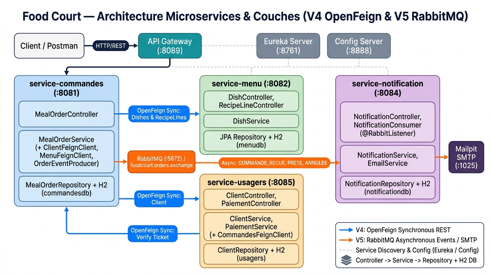

# Système Food-Court (Restauration d'Entreprise)

## 1. Description du Projet
Système distribué de gestion des commandes de repas pour les collaborateurs d'une entreprise via leur badge cantine. L'application permet la prise de commande, le suivi en cuisine en temps réel, la gestion des plats, ingrédients et allergènes, la gestion des collaborateurs, la tolérance aux pannes (Resilience4j / OpenFeign), la protection contre les doublons (`Idempotency-Key`), ainsi que la notification asynchrone par email via RabbitMQ et Mailpit.

---

## 2. Architecture Globale et Ports

### Microservices Spring Boot / Spring Cloud

| Composant | Rôle & Responsabilité | Port par Défaut | Base de Données / Broker |
| :--- | :--- | :---: | :--- |
| **eureka-server** | Service Discovery (Enregistrement et découverte dynamique) | `8761` | — |
| **config-server** | Centralisation des configurations applicatives (`config-repo/`) | `8888` | — |
| **api-gateway** | Point d'entrée unique, routage dynamique et Load Balancing | `8089` | — |
| **service-commandes** | Gestion des commandes (`MealOrder`), lignes (`OrderItem`), orchestration OpenFeign/Resilience4j, idempotence et **Producer** d'événements | `8081` | H2 In-Memory + RabbitMQ (`AFTER_COMMIT`) |
| **service-menu** | Gestion de la carte (`Dish`), ingrédients, recettes (`RecipeLine`) et allergènes | `8082` | H2 In-Memory |
| **service-notification** | **Consumer** des événements JSON, persistance de l'historique et envoi d'alertes emails | `8084` | H2 In-Memory + RabbitMQ + SMTP Mailpit |
| **service-usagers** | Gestion des collaborateurs (`Client`), vérification d'unicité et statut actif | `8085` | H2 In-Memory |

### Infrastructure Docker (Broker & SMTP)

| Conteneur Docker | Image | Ports Exposés | Identifiants / Configuration |
| :--- | :--- | :--- | :--- |
| **rabbitmq-foodcourt** | `rabbitmq:3-management` | `5672` (AMQP) / `15672` (Web UI) | User: `guest` / Pass: `guest` (`http://localhost:15672`) |
| **mailpit-foodcourt** | `axllent/mailpit` | `1025` (SMTP) / `8025` (Web UI) | Interface Web de test : `http://localhost:8025` |

---

## 3. Schéma d'Architecture Actualisé (Jalon V6)



```text
                        +---------------------------------------+
                        |     Eureka Server (Port: 8761)        |
                        |     Config Server (Port: 8888)        |
                        +---------------------------------------+
                                            ^
                                            | (Découverte & Config)
  [ Client / Postman ]                      v
            |                    +---------------------+
            +--- HTTP :8089 ---> |     API Gateway     | (Port: 8089)
                                 +---------------------+
                                            | (Routage dynamique)
        +-----------------------+-----------+-----------+-----------------------+
        | /api/orders/**        | /api/v1/dishes/**     | /api/usagers/**       | /api/notifications/**
        v                       v                       v                       v
+-------------------+   +-------------------+   +-------------------+   +--------------------+
| service-commandes |   |   service-menu    |   |  service-usagers  |   |service-notification|
|   (Port: 8081)    |   |   (Port: 8082)    |   |   (Port: 8085)    |   |    (Port: 8084)    |
+-------------------+   +-------------------+   +-------------------+   +--------------------+
     |    |       |               ^                       ^                   |     ^      |
     |    |       +-- OpenFeign --+                       |                   |     |      |
     |    +---------- (Retry + CircuitBreaker + Fallback)-+                   |     |      |
     |                            |                       |                   |     |      |
     | JDBC                       | JDBC                  | JDBC              |     |      | SMTP
     v                            v                       v                   v     |      | :1025
[H2: commandes]              [H2: menu]             [H2: usagers]       [H2: notif] |      v
     |                                                                              |  +---------+
     | AMQP :5672                                                                   |  | Mailpit |
     | (AFTER_COMMIT)                                                               |  |Web: 8025|
     v                                                                              |  +---------+
+-------------------------------------------------------------------------------------------+
|                        RabbitMQ Broker (Port: 5672 / UI: 15672)                           |
|   Exchange : foodcourt.orders.exchange (Topic) -> Queue : foodcourt.notifications.queue   |
+-------------------------------------------------------------------------------------------+
