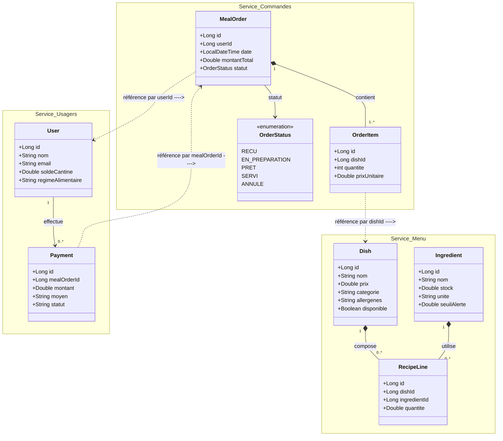

# Système Food-Court (Restauration d'Entreprise)

## 1. Description du Projet
Système distribué de gestion des commandes de repas pour les collaborateurs d'une entreprise via leur badge cantine. L'application permet la prise de commande, le suivi en cuisine en temps réel, la gestion automatisée des stocks d'ingrédients et de la disponibilité des recettes, le débit/remboursement du solde cantine, ainsi que la notification aux collaborateurs.

---

## 2. Architecture Globale et Ports des Microservices

| Composant | Rôle & Responsabilité | Port par Défaut |
| :--- | :--- | :--- |
| **eureka-server** | Service Discovery (Enregistrement et découverte dynamique) | `8761` |
| **api-gateway** | Point d'entrée unique, routage dynamique et Load Balancing | `8080` |
| **config-server** | Centralisation des configurations applicatives | `8888` |
| **service-commandes** | Gestion des tickets repas (`MealOrder`) et lignes (`OrderItem`) | `8081` |
| **service-menu** | Gestion de la carte (`Dish`), ingrédients et recettes (`RecipeLine`) | `8082` |
| **service-usagers** | Gestion des collaborateurs (`User`), solde cantine et paiements | `8083` |
| **service-notification** | Consommation des événements et envoi des alertes emails | `8084` |

### Schéma d'Architecture Logique

```text
               +-------------------------------------------------+
               |           Eureka Server (Port: 8761)            |
               +-------------------------------------------------+
                                       ^
                                       | (Enregistrement & Découverte)
 [ Client / Frontend ]                 |
           |                           v
           v                   +---------------+
     +-----------------------> |  API Gateway  | (Port: 8080)
                               +---------------+
                                       | (Routage dynamique)
           +---------------------------+---------------------------+
           |                           |                           |
           v                           v                           v
  +------------------+        +------------------+        +------------------+
  | service-commandes|        |   service-menu   |        | service-usagers  |
  |   (Port: 8081)   |        |   (Port: 8082)   |        |   (Port: 8083)   |
  |  [DB: commandes] |        |    [DB: menu]    |        |   [DB: usagers]  |
  +------------------+        +------------------+        +------------------+


```
## 3. Diagramme de Classes UML Global (Gestion des Références Distantes)



